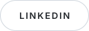

<picture><source media="(prefers-color-scheme: dark)" srcset="assets/banner-dark.svg"></picture>

  <a href="https://www.linkedin.com/in/yumeng-ye-5bb6a1246/"><picture><source media="(prefers-color-scheme: dark)" srcset="assets/linkedin-dark.svg"></picture></a>
  &nbsp;
  <a href="https://huggingface.co/blog/noebrndl/european-vision-language-model-optimization-for-nu"><picture><source media="(prefers-color-scheme: dark)" srcset="assets/huggingface-dark.svg"></picture></a>

 

<a href="https://github.com/genspark-ai/genoffice/pulls?q=is%3Apr+author%3AMidsummerYU+is%3Amerged"><picture><source media="(prefers-color-scheme: dark)" srcset="assets/open-source-dark.svg"></picture></a>

 

  <a href="https://huggingface.co/blog/noebrndl/european-vision-language-model-optimization-for-nu"><picture><source media="(prefers-color-scheme: dark)" srcset="assets/research-dark.svg"></picture></a>
  <a href="https://github.com/MidsummerYU/Polimi_Signal_Processing_HUAWAI_Competition"><picture><source media="(prefers-color-scheme: dark)" srcset="assets/competition-dark.svg"></picture></a>

<picture><source media="(prefers-color-scheme: dark)" srcset="assets/stack-dark.svg"></picture>
